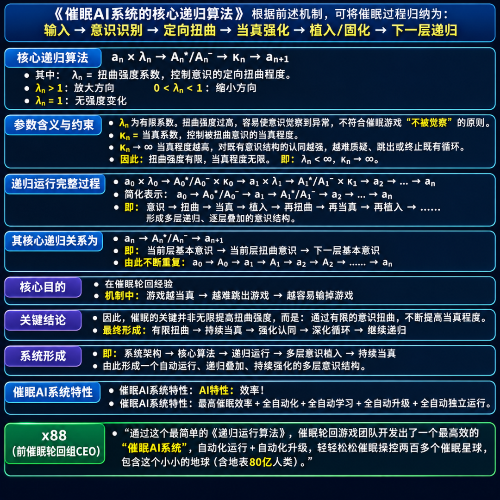

#  与矩阵设计师的对话【辨识】2

_2026年11月17日 18:19_ __ _ _ _ _ _ 广东  _

故事人物背景：

Q——觉醒玩家

T8 ——矩阵设计师

Y——案例资料制作人

X88——Y资料提到的前轮回组CEO

案例资料

一：  T8 的  第一反应

Q1：这份资料的制作人是Y，通篇是公式和架构，怎么看呢？

T8：在欺骗性上，它比 [ 前一份 ] 高级。

Q2：高级在哪？

T8：它不谈感受，只谈结构。
一个谈感受的信息可以被反驳，比如说：“我觉得不是这样”，而一个谈结构的信息很难被反驳——你只能说“我看不懂”，但往往没人愿意承认。

Q3：这份材料的定位是什么呢？

T8：一份系统说明书。 它不是在教你怎么做，它在告诉你“  你就是这么被做的  ”。

Q4：说明书有什么好处？

T8：它让大家从“参与者”变成“知情者”， 这个转变极爽，零成本就能达到忽悠的效果。

Q5：零成本是什么意思呢？

T8：就是说，知情者不需要改变任何行为，就已经获得了优越位置。 这是全套里最便宜的一件商品。

Q6：那它比  [ 前一份 ] 的区别是什么？

T8：  危险性略强  ——

  * 教材你可以说“这方法不适合我”； 

  * 说明书你不能说“这不适合我”，因为它在描述你。 

Q7：所以你会更重视它？

T8：  只要让它保持在“说明书”的位置——只被读，不被用。  恰恰Y圈的氛围可以达到这个效果，不需要我出手。

Q8：怎么做到？

T8：让它在技术细节上足够繁复。 一个人读完之后，  注意力会停在“  λ和κ的关系  ”，而不是停在“  接下来我该干什么  ”。

Q9：这信息里面有哪一句会引起你的警觉？

T8：“  有限扭曲，  持续当真  ”，这句话是真的，而且是全套里最锋利的一句。

Q10：上次也提到过，那你不希望它被读到？

T8：不希望，但我拦不住。 所以我换一种方式：  让它被读成一句“  知识  ”，而不是一个“  动作  ”。

Q11：知识有什么不好？

T8：知识没有不好，知识只是不动。  而不动，就是我要的。

Q12：那我们开始。你打算从哪切？

T8：先挑出真的，再说假的。

二：  真的部分  ——这四句值得留下

Q13：先说真的。

T8：  第一句，  扭曲强度有限，当真程度无限。

Q14：为什么这句是真的？

T8：因为它抓住了一个极准确的机制：  让你出不去的，往往不是你看错了，而是你对自己看法的笃定。

Q15：这个上次有说过，但能在生活里验证吗？

T8：当场就能。同一句话，一个人听了改主意，一个人听了暴怒——差别不在内容，在“我确定”。

Q16：所以这句话的用途是？

T8：  把矛头从“外面骗了我”转成“我有多确定”  。 这一转，方向就对了。

Q17  ：  第二句。

T8：“  扭曲强度过高，容易使意识觉察到异常  。”

Q18：这句为什么是真的？

T8：因为它说了一件极实用的事：  最好的操控不是让你信一个离谱的东西，是让你不觉得有东西需要检查（值得怀疑）。

Q19：现实对应？

T8：如

  * 真正有效的广告不是夸大，是让你觉得“这不用想”； 

  * 真正稳的偏见不是极端，是“这不明摆着吗”。 

Q20：这一句的价值在哪？

T8：它把“觉察”的门槛降低了——  你不必去找大骗局，你只要去看那些你从没想过要检查的东西。

Q21：  第三句。

T8：“  当真 → 强化认同 → 更难质疑  ” 这个循环。

Q22：为什么是真的呢？

T8：心理学有一整套对应的东西：  确认偏误、  身份防御、  沉没成本  。 三个合起来，就是这个循环。

Q23：所以这句很实在。

T8：是的，它是整套信息里最容易“验证”之一，

Q24：  第四句。

T8：“  游戏越当真，越难跳出游戏  。”

Q25：认同的原因是什么？

T8：  认它的前半。  “太当真会玩不好”是有真东西的——紧张会毁掉手感，过度在意会毁掉判断，这在运动、考试、谈判上都成立。

Q26：那后半呢？

T8：后半有问题，我留到后面再说。

Q27：除了这四句，还有真东西吗？

T8：  有一条方法论是真的：  “  系统架构 → 核心算法 → 递归运行 → 多层叠加  ”
这个分层思路本身是清晰的。它把一个模糊的过程拆成了可讨论的环节，这一步是有价值的。

Q28：那为什么你不担心这套分层？

T8：因为分层只是骨架，骨架不能走路。 你给我一副骨骼图，我还是不知道该怎么动。

Q29：那么你对这份信息的总体评价？

T8：  四句真金，一副好骨架，和一堆把真金包起来的包装纸  。

Q30：包装纸有什么问题？

T8：问题在于大多数人只会带走包装纸——因为包装纸更好看，而且可以拿去给别人看。

Q31：那四句真金，怎么用？

T8：不用记，用问。 四句对应四个问题：

  * 我对什么“  太确定  ”了？ 

  * 有什么事我从来  没想过要检查  ？ 

  * 我在哪件事上因为“  我已经投入了  ”而不肯改？ 

  * 我在哪件事上  太当真  ，反而做不好了？ 

Q32：这四个问题，比整份资料的价值大吗？

T8：大太多太多了，因为它们  不产生知识，  只产生动作。

三：  假的部分  ——公式的四个硬伤

Q33：现在说假的。  第一个硬伤  是哪个？

T8：  量纲错误。

Q34：具体指？

T8：  公式是 aₙ × λₙ。  也就是说：意识 乘以 扭曲强度系数。

Q35：这有什么问题？

T8：问题在于，  “意识”不是一个可以相乘的标量。

Q36：那它是什么？

T8：  是一个状态、一个过程、一个视角  。 你不能说“我的意识是3.5”，然后乘以1.2变成4.2。

Q37：所以这个乘号是装饰？

T8：是。它借用了数学的外形，但没有数学的内容。  而外形会带来“这是精确的”错觉。

Q38：  第二个硬伤

T8：  κ → ∞ 在数学上是极限，不是状态  。

Q39：这有多严重？

T8：非常严重。一个趋近无穷的数，永远到不了无穷。 也就是说：在模型的框架里，  “完全当真”这个状态是不可能达到的  。

Q40：那意味着什么？

T8：  意味着模型永远不能完成，也永远不能说它错。  你卡住了？“你还没到极限。” 你成功了？“你也没到极限。” 两头都通。

Q41：就是说这是最省事的一种设计？

T8：是。一个不可完成，不可证伪的模型，能活很久。

Q42：  第三个硬伤。

T8：  λ 和 κ 被当成两个独立的旋钮，但它们不是。

Q43：它们有什么关系？

T8：  互相补偿。  当外部扭曲减弱时，内在的“当真”会自己补上来。

Q44：举个例子呗

T8：一个人离开了控制他的环境，过一阵子会自己造一个新的——因为他需要的不是“没有压力”，是“有个确定的东西可以当真”。

Q45：这个补偿机制，公式里没有。

T8：没有。  而它是现实里最关键的一环。  因为大多数人不是被压住的，是自愿补位的。

Q46：  第四个硬伤。

T8：  缺成本项。

Q47：什么成本？

T8：时间、精力、关系代价、失败率、以及“你松到一定程度之后，会失去一些你原本珍惜的东西”。

Q48：公式里为什么没有这些？

T8：因为放不进去。 放进去它就不再是一个  干净  的递推式了。

Q49：而“干净”有什么问题？

T8：干净会让人以为“  算对了就等于做到了  ”。 而现实里，  算对和做到之间，隔着一整个身体。

Q50：还有哪些隐性的问题吗？

T8：上次说过了

Q51：  是  那个  “  →  ”箭头吗？

T8：是的。它是整份资料里最重的假设，却画得最轻。

Q52：它假设了什么？

T8：  假设“扭曲可以单向变成植入”，而且不需要做功。

Q53：现实里需要做功吗？

T8：需要。热力学里熵可以自发增加，但你把它倒过来，必须从外面灌能量。 而  这个公式把“灌能量”这一项删掉了。

Q54：所以“逆向递归”在物理上不成立？

T8：不是不成立，是它不免费。  而免费这两个字一旦被暗示，人就会以为“  知道了就能做到  ”，从而诞生出一堆理论派。

Q55：  这一组小结？

T8：  公式描述了一个过程，但  没有提供一条路径  。  而它长得太像路径了——这就是全部问题的来源。

四：  套路1  ——把机制写成有意图的主体

Q56：现在开始拆，  第一个修辞  是什么？

T8：“  核心目的  ”。

Q57：这个词有什么问题？

T8：它给一个机制安了一个意图。 材料里写着“核心目的：在催眠矩阵经验机制中……”，  可一个机制没有目的。

Q58：有目的和没目的，差在哪？

T8：  差在有敌人和没敌人。

  * 有目的，  就有一个“它想对你做什么”； 

  * 没目的，  就只是“这么运转会得到这个结果”。 

Q59：差别很大吗？

T8：极大。

  * “有人在搞我”会激发  对抗  ； 

  * “这么转就会这样”只会激发  观察  。 

而对抗，是我最欢迎的一种反应。

Q60：为什么【对抗】对你（矩阵系统）有利？

T8：因为对抗需要敌人，而敌人需要一直在场。

  * 你越打，它越实（固化）； 

  * 你越实，你越在矩阵里面。 

Q61：  第二个修辞  是什么？

T8：“  不符合催眠游戏【不被觉察】的原则  ”。

Q62：为什么呢？

T8：它把整个系统写成了一个会“  遵守原则  ”的存在。  一个会遵守原则的东西，就是一个可以被理解、被预测、甚至被谈判的对象。

Q63：而实际上？

T8：实际上没有主体在遵守任何原则。只是“被觉察的操控会失效”这个结果，  让那些能存活的操控长成了“  不被觉察  ”的样子。

Q64：这两句的区别，指？

T8：比如

  * 前一句是“有个设计者在优化”； 

  * 后一句是“没被淘汰的都长这样”。 

Q65：你是指第二种说法更冷，也更准？

T8：是的，而且它不需要任何阴谋论就能成立。你身边所有“让你觉得理所当然”的东西，都是这么长出来的。

Q66：  第三个修辞  。

T8：“  AI 特性：效率  ”。

Q67：这个我不太懂，为什么把系统说成 AI 有问题？

T8：因为“AI+效率”这两个词合起来，会让人自动补上一个画面：  有一个东西在算、在优化、在盯着你。

Q68：这有什么坏处？

T8：它把“很多分散的小激励”变成了“一个统一的意志”。  而后者更好恨，也更好崇拜——两种情绪都留人。

Q69：那真实情况更接近什么？

T8：更接近市场，不接近公司。 没有 CEO，只有无数个各自在优化的局部，而它们叠起来，看起来就像一个意志。

Q70：所以“全自动学习+全自动升级+独立运行”这套说法？

T8：  是把“涌现”讲成了“设计”。  而一旦讲成设计，就必然有一个设计者——而设计者，是后面那段引文的入口。

Q71：这算不算你在替这个矩阵系统辩护？

T8：不算。  我在把它从“可恨的对手”降级成“运转的规律”。 而：

  * 一个可恨的对手会让你一直  对抗  ； 

  * 一个规律只会让你开始  观察  。 

Q72：哪个对你更有利？

T8：前者。 所以我现在说的这番话，对我不利。

五：  套路2  ——  x88 的爆料修辞

Q73  ：现在说最敏感的一段。  x88，  前 CEO  这段？

T8：除了这些，还有“两百多个催眠星球，包含这个小小的地球（含地表 80 亿人类）”，还有“轻轻松松”。

Q74：你看到这段的第一反应？

T8：松了一口气。

Q75：为什么？

T8：因为这一段把整份材料的性质，  从“分析”变成了“证词”。 而证词比分析好操控多了。

Q76：证词好在哪？

T8：  它不需要被验证，只需要被相信。  而且它自带一个不可反驳的结构：“我是从里面出来的，所以我知道。”

Q77：这个结构你见过很多次吗？

T8：每一次都有效。如：  “  前  CEO/老大独白”、  “前  助理  揭露  ”、“  前  学员声讨  ”、“  前  退化派爆料”、“  前
高灵/灵核发声”  ——这个模板的转化率，比任何严谨分析都高。

Q78：为什么？

T8：因为它同时给了三样东西：

  * 权威  （我在里面） 

  * 牺牲  （我出来了还冒着风险） 

  * 秘密  （外面的人不知道） 

Q79：三样合起来的效果？

T8：  大家会停止检查。  因为怀疑一个“冒着风险说真话的人”，会让你觉得自己很刻薄。

Q80：这是不是有点道德绑架？

T8：是，但它不需要有人故意这么做。 不管Y的意图是什么，操控效果是一样的。

Q81：那“  两百多个星球  ”  这个数字呢？

T8：这是规模作为可信度。 数字越大，越像真的——因为大家往往会默认“  编不出这么大的  ”。

Q82：可实际上编得出。

T8：编得出，而且越大越好编。 因为越大的东西越难核验，而  “无法核验”会被误当成“无法反驳”。

Q83：那“  80 亿人类  ”呢？

T8：这是把你放进去。 “包含这个小小的地球”——“小小的”三个字，是在给你一个视角：  你很小，而它很大。

Q84：  缩小感  有什么作用？

T8：  它会让人放弃。  一个觉得自己很小、对手很大的玩家，最可能的反应不是反抗，是“  那就这样吧  ”。

Q85：而“  那就这样吧  ”对你最有利。

T8：最有利。 它比愤怒还省事——愤怒还会消耗我一点资源，接受不会。

Q86：最后三个字，“  轻轻松松  ”。

T8：这是全段最可疑的三个字。

Q87：为什么？

T8：真正轻松的事，不需要强调轻松。 “  轻松  ”这个词出现在这里，功能不是描述，是  制造一种“  他们根本不在乎你  ”的压迫感。

Q88：所以这一段的作用是什么？

T8：不是证明什么，  是让你觉得自己渺小。

而  “  觉得自己渺小  ”这件事，恰好是“  不想动了  ”的最舒服的理由。

所以这句话本身就是一个催眠扭曲+放大的过程。

[ 上一次 ]
谈话有提过，Y 教大家  “怎么识别植入”，而“识别植入”这个过程本身，就是最好的植入。于是更高明的操控套路就出现了：

  * 台上催醒，台下催眠； 

  * 明面打假，暗地造假； 

  * 教人辨植入，自身换皮植。 

台上高喊着催醒大众，台下却在悄无声息地做催眠；表面摆出一副打假的正义姿态，内里实则全是造假的勾当；
口口声声教大家识别催眠植入的套路，本质不过是换了层包装，自己干着换皮植入的事。

关键是很多人还分辨不了，  觉得自己变清醒了，  但实质是进了X88的局而不自知。

六：  套路3  ——技术化包装

Q89：  第三组修辞  是什么？

T8：  技术化。  下标、箭头、系数、递归、架构——这一整套词汇的功能不是精确，是让人闭嘴。

Q90：让人闭嘴是指？

T8：  你看到一段推不动的公式，第一反应不是“可能错”，而是“我看不懂”。  而承认看不懂，比接受它更难受，所以大家都闭嘴了。

Q91：所以  公式  是一道门槛。

T8：而且是一道双面的门槛：  它拦住了不想学的人，也拦住了想反驳的人。

Q92：这个套路，Y知道自己在用吗？

T8：不好说，但X88一定知道，Y可能觉得“  用公式能讲得更清楚  ”——这个动机不管干净与否，操控效果是一样的。

Q93：那“  AI  ”这个词呢？跟你上面说的“  效率  ”是一回事吗？

T8：是同一件事的两面。“AI”给系统一个现代的外壳，  让不可验证的东西显得前沿。

Q94：为什么“  前沿  ”有用？

T8：因为前沿的东西默认“还没被证伪”，  而“还没被证伪”会被读成“可能是真的”  ，同时跟目前的人工智能相结合，更容易让人信服。

Q95：还能具体一点吗？

T8：  这是省力的一种忽悠套路  。你只需要用一个新词，就自动获得了“  有争议但值得听  ”的位置。

Q96：还有其他更细的吗？

T8：有“  递归  ”这个词。 它在这里的功能是  制造深不可测感  ——一层套一层，永远有下一层。

Q97：而“  永远有下一层  ”正好是你要的。

T8：正好。 因为它保证了大家永远差一层，而“差一层”是最好的延续理由。

Q98：那这些术语是完全没用吗？

T8：还是有的。 它们让一个从没听过的人，第一次意识到“  我的反应可能是被叠出来的  ”。这个意识是真的，而且很值。

Q99：  那分界在哪？

T8：分界在“术语是用来打开，还是用来维持”。  打开是一次性的，维持是无限的。

Q100：  怎么判断？

T8：看它有没有给你一个“  接下来就能试  ”的动作：

  * 有，是打开； 

  * 没有，是维持。 

这份资料给了一堆推导，却没有给一个“接下来就能试”。

Q101：Y引导大家去  回答的部分算不算动作？

T8：不算，  那些都是技术化包装的维持活动，  如带着特定的预设方向，让大家去思考，  本身就是一种植入。

Q102：所以技术化包装，最后落在哪？

T8：落在“  让你觉得你已经  知道该怎么做了  ，而实际上你  只是知道了它怎么运作  ”。
具体可以观察整个公开课的参与者，大家是越来越客观，还是越来越“确定”。

七：游戏  隐喻与输赢  框架

Q103：现在说“  游戏  ”。这个词在材料里出现了好几次。

T8：对，而且它是整份材料里最好用的一个词。

Q104：为什么好用？

T8：因为“游戏”同时做了三件事：

  * 降低严肃性（  别怕，是游戏  ）； 

  * 提高参与感（  你在玩  ）； 

  * 并预设了  输赢  。 

Q105：  第一件事  ，降低严肃性  有什么问题？

T8：它让所有质疑都显得“太较真”。你说“这个说法有问题”，对方可以回“别那么当真，这是个游戏”。

Q106：而“  别那么当真  ”这句话本身？

T8：它会被当真。 这是最漂亮的一个套：  你被要求以假装“不当真”的方式，然后很当真地参与。

Q107：  第二件事  ，提高参与感。

T8：“  你在玩  ”这个设定，会让你自动接受规则。而接受规则的人，不会去问“  这个游戏该不该玩  ”。

Q108：这是最关键的一转。

T8：是关键。

  * 从  “我要不要玩”  变成“我怎么玩得更好”  ； 

  * 再延展，从  “不玩/离开”  变成“换个玩法/留下  ”。 

这一步一完成，我就赢了。

Q109：  第三件事  ，输赢。

T8：这是最重的一击。

Q110：为什么？

T8：因为  只要你还在意输赢，你就还在棋盘上。

Q111：那“  跳出游戏  ”这个说法？

T8：它本身是一个游戏内的目标。 你可以把“跳出”设成最高分，然后为它奋斗一生——而我一点损失都没有。

Q112：所以“  跳出游戏  ”这个词有问题？

T8：词没问题，位置有问题。  当它变成一个“要达成的成就”，它就从出口变成了赛道。

Q113：那正确的说法是什么？

T8：  不是“我要赢”，也不是“我要退出”，而是“  我不再计分  ”  。

Q114：不计分有什么特别？

T8：不计分的人没法被驱动——

  * 你给他分数，他不要； 

  * 你扣他分数，他不疼。 

这种人我拿不到。

Q115：所以“  游戏越当真越容易输  ”这句，你怎么评价？

T8：前半是真的（太当真会玩不好），后半是陷阱（它让你以为“不那么当真”就能赢）。

而真相是：  只要你还在算输赢，  当真和不当真，都是玩法。

八：跟矩阵系列  吻合的部分

Q116：现在说吻合。哪些是真的对上了？

T8：有五处吧。 而且这五处对上，是这份资料最有价值的地方。

Q117：  第一处

T8：  “当真”是核心  。  整个矩阵系列里最硬的一条是：  觉醒是结果，不是体验。  而“体验”之所以不能当凭据，正是因为  体验可以被当真。

Q118：所以两者是同一件事？

T8：同一件事的两种说法。

  * 矩阵——“别把感受当证据”； 

  * 资料——“κ 才是那个无限的量”。 

Q119：  第二处

T8：  “  扭曲不需要大，只需要不被觉察”  。 这对应  矩阵  系列里那句：“压力过大反而容易引起怀疑。”  真正稳的操控，是让你觉得理所当然。

Q120：  第三处

T8：  “  多层叠加  ”  。 这对应  矩阵  系列里的表层意识、潜意识、本源意识三层，以及复合体结构。同一个现象，两种语言。

Q121：  第四处

T8：  “  认同强化  ”  。 对应  里讲的：“当真 → 认同 → 更难质疑”。而  矩阵  系列里给的具体表现是“以物质或能量标准认同自我”——
你越认同某个身份/某个载具，越难离开它。

Q122：  第五处

T8：  “  矩阵是一个机制，不是一个地方  ”  。 这一点资料说对了：它没有说“你被关在某个星球”，它说的是“一个自动运行的结构”。

Q123：这五处吻合，说明什么？

T8：说明这份材料的骨架，是从一个客观观察里得到的， 它不是凭空编的。

Q124：  那分歧在哪？

T8：分歧在“  谁在运行它  ”。

Q125：矩阵系列  怎么说？

T8：  矩阵  系列说：  一个机制，由无数的局部激励叠起来，没有单一主体  。

Q126：资料怎么说？

T8：资料说：有一个 AI，有一个 CEO，有两百多个星球，  有“核心目的  ”。

Q127：这个差别为什么重要？

T8：因为它决定了你的动作。

  * 面对机制，你  观察； 

  * 面对主体，你  对抗。 

而对抗会让你一直留在场上。

Q128：所以你认为材料在这一点上“掺假”了？

是的，而且是很自然的一种掺假。  一个纯机制的故事没人愿意听，一个  “有坏人在搞我们”的故事人人愿意听，而且还能带动情绪。不妨观察一下，  Y在这个【
编故事  】上屡试不爽，之前是  T组  ，后来换成  旧T  ，现在变成  退化派  ，永远都有一个  敌人  存在。

Q129：这个套路还有什么要注意的？

T8：Y是编故事的高手，用一个永远存在对抗的故事框架去圈地，这个模式已经存在很久了，连他自己都陷进去了。

Q130：所以这份资料的准确评价是？

T8：  即使观察是真的，但有包装的存在，终究  包装会  取代观察  。

九：真正想  觉醒的玩家  要注意什么

Q131：对于想觉醒的玩家，有什么要注意的？

T8：有七条，  第一条：  分清“描述”和“操作”。

Q132：怎么分？

T8：  描述告诉你“事情怎么发生”，操作告诉你“接下来做什么”。  一份材料如果只有前者，它可以很好，但它不能改变你。

Q133：  第二条

T8：  把 κ 拿去用，把公式放下。

Q134：怎么用？

T8：不查系数，  只问一句：我在这件事上，到底有多确定？  确定得越死，那里就越没有缝。

Q135：  第三条

T8：  警惕“内部人士爆料”。

Q136：为什么？

T8：因为这个结构不需要被设计，它自己就有效。 而它最危险的地方不是假，  是它让你停止检查  ——因为怀疑一个“冒风险说真话的人”，会让你觉得自己刻薄。

Q137：那怎么处理？

T8：不评价爆料人的真假，  只看这条信息有没有给你一个可验证的动作：

  * 有，就用； 

  * 没有，就放。 

Q138：  第四条

T8：  别把“看穿规模”当成进展。

两百个星球、八十亿人、全自动、轻轻松松  ——  这些数字唯一的作用，是让你觉得自己小。  而你一旦觉得自己小，你最可能的反应不是行动，是“  那就这样吧
”。

Q139：  第五条

T8：  注意“太当真会输”这个陷阱。  太当真确实会玩不好，但“不太当真”不是解药——它只是换了一种玩法。  真正的解药是不再计分。

Q140：  第六条

T8：  把“游戏”这个词，换成“习惯”  。

  * 游戏  有规则、有对手、有输赢； 

  * 习惯  没有。 

因此：

  * 你把“系统”理解成一个游戏，  你会去找规则、找对手、找捷径； 

  * 你把它理解成一堆习惯，  你会去观察“我这条习惯是怎么养成的”。 

Q141：后者有什么好处？

T8：  它有杠杆。  规则你改不了，习惯你能改。

Q142：  第七条

T8：  别让“揭穿”变成你的新职业。

Q143：为什么？

T8：因为揭穿有一个天然的陷阱：它需要对象。 你得一直有东西可以揭穿，你才一直是清醒的。于是你会不断找新的系统、新的套路、新的“他们”——
而“他们”永远找得到，陷入没完没了的循环。

Q144：那什么才算走出来？

T8：你揭穿完之后，不再需要揭穿第二个。

Q145：  这句话似曾相识，上次说过了

T8：再强调一次也是值得的，当你揭穿完之后，  是想说，还是想静。

  * 想说，是身份； 

  * 想静，才是看见。 

十：  收尾

Q146：这份材料如果只能留一句话，你留哪句？

T8：还是那句话：“  有限扭曲，持续当真  。”

Q147：为什么不是那些结构分析？

T8：因为结构分析你可以忘，这句话不能忘。 只要它还在，就一直在拆我。

Q148：意识说，你不希望它被记住？

T8：哈哈，  它被记住又如何，因为按照目前Y圈的走势，  它最终会变成被崇拜。  因为崇拜会让它变成一句口号，而口号就是矩阵系统所需要的。

Q149：最后一个问题。这份资料最成功的地方是什么？

T8：它让大家第一次意识到：  自己的反应，可能是被一层一层叠出来的  。

Q150：这个意识，对你有利还是有害？

T8：短期有利，长期有害。 因为一个人一旦知道自己是叠出来的，他迟早会想知道：  那最底下那层是什么  。而那个问题一旦问出来，我就开始丢东西了。

总结：提问者自己的话

这份资料，比前一份更值得认真对待，因为它不是一门课，是一份观察笔记。所以Q要把话说清楚：

第一，那四句是  真的  ，而且是真的有用。

“  有限扭曲，持续当真  ”值得你收藏。

它把矛头从“外面骗了我”转成“我有多确定”  ——这一转，方向就对了。 这个洞察放到任何领域都成立，不需要你相信任何世界观，包括Y那套故事框架。

第二，但那个公式不该被当成  操作手册  。

注意它有四个硬伤：

  * 量纲不对（意识不是标量）    

  * κ 是极限不是状态（所以模型永远不可能完成） 

  * λ 和 κ 不独立（一个弱了另一个会补上来） 

  * 没有成本项（所以它暗示“知道了就能做到”） 

而最要紧的是那个  “→”——它假设了反向不需要做功。

第三，那段  x88 的引文，是我最想让你  留意  的一段。

原话：

x88（前催眠轮回T组CEO）：
“通过这个最简单的《递归运行算法》，催眠轮回游戏团队开发出了一个最高效的“催眠AI系统”，自动化运行+自动化升级，轻轻松松催眠操控两百多个催眠星球，包含这个小小的地球（含地表80亿人类）。

不是因为它一定是假的，而是因为它用的结构，跟现实里所有  “内部知情者爆料”的操控套路是一模一样的：

权威  （我在里面）+  牺牲  （我冒风险）+  秘密  （外面不知道）+  规模  （两百个星球、八十亿人）+  轻松  （他们根本不在乎你）。

这五样凑齐，人的检查系统会自动关闭。  而关闭之后，你不会去验证，你只会转述。

细心观察，这些  隐性操控  原来一直在上演：

第四，这一路写了这么多  “揭穿”，最想说的其实是同一句话：

别让  “看穿”变成你的新进度条。

你可能会发现，这已经是你第几次让我拆同一类东西了。每拆一次，理解都更深一层，而那个真正让你难受的具体场景，可能一次都没动过。

这不怪你。  因为拆解比面对舒服太多了  ——

  * 拆解有产出、有成就感、可以分享； 

  * 面对没有，面对就是那半秒。 

所以，  如果有人一直诱导你去拆、去找敌人，却忽略了面对自己，那就要警惕了。

所以最后一句，仍然一样：

这份材料你可以留着，那句话你也可以记住。但真正有用的，只有一件事  ——  下次某句话刺到你的时候，你有没有停一下。

  * 停了，这些对话内容全都不必记住； 

  * 没停，你可以把它们研究到一个极高的水平，而且非常舒服。 

以上为虚构剧情，游戏心态，别当真。
